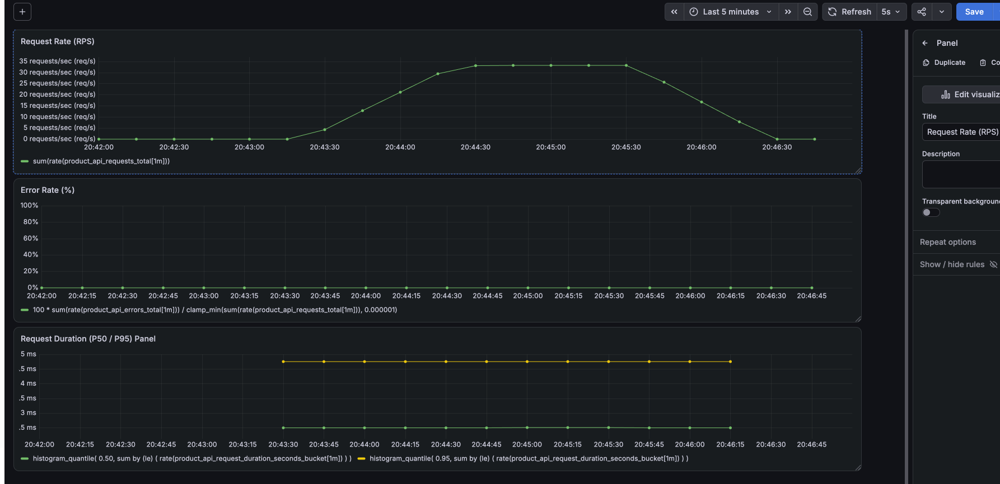

# CS6650 Homework 5 — Product API, Terraform, Load Testing, and Observability

This project implements the **Product API** portion of the supplied OpenAPI contract using Go and Gin. It stores products in memory, packages the server in Docker, deploys it to AWS ECS/Fargate using Terraform, tests it with Locust, and exposes RED (Rate, Errors, Duration) signals through Prometheus, Grafana, and JSON request logs.

## Repository layout

```
.
├── src/
│   ├── product-service.go       # Gin Product API, validation, and structured JSON logging
│   ├── metrics.go               # Prometheus RED metrics and middleware
│   ├── go.mod                   # Go module dependencies
│   ├── go.sum                   # Go dependency checksums
│   ├── Dockerfile               # Container image build
│   └── HW5_README_PartII.md     # Additional Part II documentation
│
├── terraform/
│   ├── provider.tf              # AWS and Docker provider configuration
│   ├── variables.tf             # Terraform input variables
│   ├── main.tf                  # Root deployment configuration
│   ├── outputs.tf               # Infrastructure outputs
│   ├── .terraform.lock.hcl      # Terraform provider version lock file
│   └── modules/                 # ECS, ECR, networking, and logging modules
│
├── locustfile.py                # HttpUser and FastHttpUser baseline tests
├── mixed_locust.py              # Mixed GET/POST workload tests
├── stress_locust.py             # Increasing-load stress test scenarios
│
├── compose.yaml                 # Local API, Prometheus, and Grafana services
├── prometheus.yml               # Prometheus scrape configuration
├── api.yaml                     # Provided OpenAPI specification
│
├── screenshots/
│   ├── part4HttpUser/           # HttpUser test screenshots
│   ├── part4FastHttpUser/       # FastHttpUser test screenshots
│   ├── part4HttpUserMix/        # HttpUser mixed-workload screenshots
│   ├── part4FastHttpUserMix/    # FastHttpUser mixed-workload screenshots
│   ├── part4stresstest/         # Stress tests at different user counts
│   ├── part2screenshot.png      # Product API verification
│   ├── part3(1).png             # AWS deployment evidence
│   ├── part3(2).png             # AWS deployment evidence
│   └── part5_grafana_idle_vs_loaded.png
│
├── part5_request_logs.txt       # Structured JSON request log excerpt
├── .gitignore                   # Excludes local and sensitive files
└── README.md                    # Main assignment documentation
```

### Load Testing Scripts

Three Locust scripts are used for different testing objectives:

- **`locustfile.py`**: Compares `HttpUser` and `FastHttpUser` under a GET-only workload to measure client implementation differences.
- **`mixed_locust.py`**: Tests a more realistic workload containing both product reads (GET) and product updates (POST), using both Locust user implementations.
- **`stress_locust.py`**: Exercises the server with increasing concurrent user

The local Prometheus configuration is referenced by `compose.yaml`; see that file for its exact path. The OpenAPI contract (`api.yaml`) is the reference for Product endpoint behavior.

## Part II — Product API

### Implementation

The Product API is implemented in Go using Gin, following the provided `api.yaml` contract.

- **GET `/products/:productId`** retrieves a product.
- **POST `/products/:productId/details`** updates an existing product.
- Products are stored in an in-memory Go map, initialized with three products (IDs 1, 2, and 3).
- A `sync.RWMutex` allows concurrent reads while protecting updates from data races.
- Input validation and structured JSON error responses follow the API contract.

The in-memory storage is not persistent; data resets when the application restarts.

### Running the API

**Option 1: Run with Go**

```bash
cd src
go mod download
go run .
```

This runs the API directly on `http://localhost:8080`, which is useful for local development and debugging.

**Option 2: Run with Docker**

From the repository root:

```bash
docker build -t hw05-product-api ./src
docker run --rm -p 8080:8080 hw05-product-api
```

Docker packages the Go application and its runtime environment into a container, providing a consistent deployment environment. The same Docker image approach is used for AWS ECS deployment in Part III.

Both options expose the API on port **8080**. Run only one at a time to avoid port conflicts.

### API Testing Results

The following tests were performed using `curl`:

| Test | Expected Status | Result |
|---|---|---|
| GET existing product (`/products/1`) | 200 OK | Passed |
| GET nonexistent product (`/products/999`) | 404 Not Found | Passed |
| POST valid update (`/products/1/details`) | 204 No Content | Passed |
| POST invalid JSON data | 400 Bad Request | Passed |
| POST nonexistent product (`/products/999/details`) | 404 Not Found | Passed |

Example GET request:

```bash
curl -i http://localhost:8080/products/1
```

Example POST request:

```bash
curl -i -X POST http://localhost:8080/products/1/details \
  -H "Content-Type: application/json" \
  -d '{"product_id":1,"sku":"UPDATED-001","manufacturer":"Apple","category_id":10,"weight":200,"some_other_id":100}'
```

The API also implements a `500 Internal Server Error` JSON response using Gin's custom recovery middleware. This behavior was implemented but not explicitly triggered during testing.

**Test evidence:** [Part II API Screenshots](screenshots/part2screenshot.png)

## Part III — Terraform deployment to AWS ECS

The starter infrastructure was adapted to build and push the Product API image to **Amazon ECR** and deploy it to **Amazon ECS Fargate**. The observed deployment used AWS region **`us-west-2`**, container port **8080**, one ECS task, and task resources of **0.25 vCPU / 512 MiB**.

The root Terraform configuration calls modules for ECR, ECS, networking, and logging. The ECS module depends on the image push so that service creation does not race ahead of the container image.

### Prerequisites

- Docker Desktop running (Docker CLI and daemon available)
- Terraform CLI
- AWS CLI configured with valid credentials and permission to create ECR/ECS/network/logging resources
- An AWS account with an appropriate ECS task/execution role (the class Learner Lab setup uses `LabRole`); check the role references in the Terraform configuration before deploying outside the lab
- A network/security-group configuration permitting inbound TCP port 8080 to the task if testing directly by public IP

**Do not commit AWS credentials or secrets.**

### Deploy from a different machine

```bash
git clone https://github.com/linonion/CS6650_2b_demo.git
cd CS6650_2b_demo

aws sts get-caller-identity
aws configure get region

docker info
cd terraform
terraform init
terraform fmt -check -recursive
terraform validate
terraform plan
terraform apply
terraform output
```

Review the plan before typing `yes` for `terraform apply`. Inspect `terraform/variables.tf` and provider configuration for region, naming, IAM role, and network assumptions; adjust for your account before applying. Terraform builds/pushes the image and provisions the deployment through the configured modules. On Apple Silicon, the container image must be built for the ECS task's Linux architecture (the project Dockerfile explicitly builds `linux/amd64`).

The running task's **public IP is not permanent**. Retrieve the current task's public IP through the ECS console (cluster → service → running task → networking) or your configured Terraform outputs, rather than relying on an IP copied from a previous run.

Test the deployed API:

```bash
export API_HOST='http://<ECS_PUBLIC_IP>:8080'
curl -i "$API_HOST/products/1"
```

The deployment was verified with GET `200` and POST `204`, followed by a GET reflecting the updated SKU. Screenshots:

- [`screenshots/part3(1).png`](screenshots/part3(1).png)
- [`screenshots/part3(2).png`](screenshots/part3(2).png)

**Cleanup:** When the AWS test is complete, run `terraform destroy` from `terraform/` and confirm resource deletion to avoid ongoing Fargate/ECR charges. This is separate from `docker compose down`, which only stops local containers.

## Part IV — Locust testing

### Test environment and design

Locust was run from a local machine against the ECS Product API. Both `HttpUser` and `FastHttpUser` were tested to compare client implementations. Read-heavy workloads are realistic for product browsing: GETs generally outnumber product-detail updates. An in-memory map gives average O(1) key lookup; `RWMutex` permits multiple simultaneous readers, while updates require an exclusive lock. At higher write ratios, lock contention could reduce throughput.

The test plan included:

- **Client comparison:** `HttpUser` versus `FastHttpUser` with comparable load settings.
- **Request mix:** GET-only and mixed GET/POST workloads (see `locustfile.py` for the actual task weights and payloads).
- **Increasing load:** saved stress-test runs labeled 10 users / spawn 2, 50 users / spawn 10, 100 users / spawn 10, and 200 users / spawn 20.

The users and spawn rates were **chosen for the experiment**, not mandated by the assignment. Spawn rate controls how quickly virtual users start; user count, wait time, and endpoint latency together affect achieved RPS. Comparisons are meaningful only when test duration, wait times, task mix, target, and other conditions are held consistent.

### Reproduce a test

Install Locust in a Python virtual environment:

```bash
python3 -m venv .venv
source .venv/bin/activate
pip install locust
```

For the deployed server:

```bash
locust -f locustfile.py \
  --host http://<ECS_PUBLIC_IP>:8080 \
  ProductHttpUser
```

Open <http://localhost:8089> and set the desired users and spawn rate. For the FastHttpUser run, restart Locust with `ProductFastHttpUser` in the command. The configured class names and mix scenarios can be inspected in `locustfile.py`.

### Stress Test Results and Analysis

I used Locust to test the Product API deployed on AWS ECS Fargate, gradually increasing concurrency to evaluate throughput, latency, and system stability.

#### Test Results

| Test Configuration | Total Requests | Failures | Observed RPS | Avg Latency | P95 |
|---|---:|---:|---:|---:|---:|
| HttpUser (10 users) | 363 | 0 | 6.9 | 15.32 ms | 24 ms |
| FastHttpUser (10 users) | 393 | 0 | 6.9 | 12.83 ms | 18 ms |
| FastHttpUser (50 users) | 115,293 | 0 | 2,752.4 | 17.40 ms | 43 ms |
| FastHttpUser (100 users) | 153,672 | 0 | 3,076.6 | 29.81 ms | 76 ms |
| FastHttpUser (200 users) | 257,994 | 0 | 3,577.9 | 51.79 ms | 97 ms |
| FastHttpUser (1000 users) | 228,044 | 0 | 4,194.7 | 193.83 ms | 380 ms |
| FastHttpUser (5000 users) | 292,862 | 83,260 | 4,744.6 | 563.98 ms | 1500 ms |

*Note: RPS values are observed rates from Locust, not necessarily full-run averages. Baseline tests used 1–2 second wait times, while stress tests used zero wait time.*

#### Performance Analysis

**Throughput and latency:** Throughput increased with concurrency, but gains gradually diminished. From 200 to 1000 users, RPS increased by only 17%, while P95 latency rose from 97 ms to 380 ms. This suggests increasing performance pressure. The in-memory map and `sync.RWMutex` allow efficient concurrent GET operations without database I/O.

**Bottleneck identification:** At 5000 users, the test recorded 83,260 failures (28.43%). However, all failures were `OSError(49, "Can't assign requested address")`, indicating client-side networking resource exhaustion rather than HTTP server errors. Therefore, the test identified a limitation of the load-generation environment, but did not establish the ECS server's definitive maximum capacity.

### Screenshot evidence

**HttpUser:**

- [`screenshots/part4HttpUser/part4ProductHttpUser.png`](screenshots/part4HttpUser/part4ProductHttpUser.png)

**FastHttpUser:**

- [`screenshots/part4FastHttpUser/part4FastHttpUser.png`](screenshots/part4FastHttpUser/part4FastHttpUser.png)

**Mixed requests:**

- [`screenshots/part4HttpUserMix/part4HttpUserMix.png`](screenshots/part4HttpUserMix/part4HttpUserMix.png)
- [`screenshots/part4FastHttpUserMix/FastHttpUserMix.png`](screenshots/part4FastHttpUserMix/FastHttpUserMix.png)

**Stress tests:**

| Run | Screenshot |
|---|---|
| 10 users, spawn 2/s | [10user2ramp.png](screenshots/part4stresstest/10user2ramp.png) |
| 50 users, spawn 10/s | [50user10ramp.png](screenshots/part4stresstest/50user10ramp.png) |
| 100 users, spawn 10/s | [100user10ramp.png](screenshots/part4stresstest/100user10ramp.png) |
| 200 users, spawn 20/s | [200user20ramp.png](screenshots/part4stresstest/200user20ramp.png) |

The comparison folders also contain Locust charts for **number of users**, **response times**, and **requests per second**.

## Part V — Observability (RED)

### Local stack

The server uses the Prometheus Go client and exposes `GET /metrics`. The custom Gin middleware records metrics by HTTP method and route:

| RED signal | Metric | Meaning |
|---|---|---|
| Rate | `product_api_requests_total` | Request counter (labels include method, route, status) |
| Errors | `product_api_errors_total` | Counter for non-2xx responses |
| Duration | `product_api_request_duration_seconds` | Histogram of request processing time in seconds |

Prometheus scrapes the container's `/metrics` endpoint; Grafana reads from Prometheus. The Compose stack runs **locally**, not on ECS.

Start the stack from the repository root:

```bash
docker compose up -d --build
docker compose ps
```

Access:

- Product API: <http://localhost:8080/products/1>
- Raw metrics: <http://localhost:8080/metrics>
- Prometheus: <http://localhost:9090>
- Grafana: <http://localhost:3000>

In Prometheus, confirm the `product-api` target is **UP** and `up{job="product-api"}` equals `1`. If Grafana has no Prometheus data source, add one using **`http://prometheus:9090`** as the URL. That hostname resolves **inside the Docker Compose network**, not from a normal host-browser address bar.

### Grafana queries

The dashboard contains three time-series panels. The following PromQL expressions use a 1-minute rate window:

**Request Rate (requests/s)**

```promql
sum(rate(product_api_requests_total[1m]))
```

**Error Rate (%) — non-2xx**

```promql
100 * sum(rate(product_api_errors_total[1m])) / clamp_min(sum(rate(product_api_requests_total[1m])), 0.000001)
```

**Duration p50 (seconds)**

```promql
histogram_quantile(0.50, sum by (le) (rate(product_api_request_duration_seconds_bucket[1m])))
```

**Duration p95 (seconds)**

```promql
histogram_quantile(0.95, sum by (le) (rate(product_api_request_duration_seconds_bucket[1m])))
```

Set the Grafana panel unit to **milliseconds** for duration (Grafana converts the seconds returned by Prometheus for display). Histograms estimate quantiles from bucket boundaries; a flat line can reflect bucket granularity rather than perfectly constant latency.

### Idle versus loaded experiment

A separate **local** Locust run targeted `http://localhost:8080` so that the Grafana dashboard and server logs reflected the **same container and run**:

```bash
locust -f locustfile.py \
  --host http://localhost:8080 \
  ProductHttpUser
```

The run used **50 users**, spawning at **10 users/s**, for approximately **2 minutes**, followed by an idle period. In the Grafana screenshot, request rate rose from near zero to approximately **33 RPS**, stayed elevated while Locust ran, then returned to zero after stopping. The error rate remained **0%**, and p50/p95 duration series were visible. The server-side durations were much shorter than network-inclusive Locust response times.



### Structured request logs

The Gin logger emits **one JSON object per HTTP request** with timestamp, method, endpoint, HTTP status, and duration in milliseconds. For example, from the same local run:

```json
{"timestamp":"2026-10-19T03:45:31Z","method":"GET","endpoint":"/products/1","status":200,"duration_ms":0.052}
{"timestamp":"2026-10-19T03:45:31Z","method":"GET","endpoint":"/products/1","status":200,"duration_ms":0.095}
{"timestamp":"2026-10-19T03:45:32Z","method":"GET","endpoint":"/products/1","status":200,"duration_ms":0.056}
```

The complete saved excerpt is [`part5_request_logs.txt`](part5_request_logs.txt). The sample's `0.052` milliseconds means **52 microseconds** of server-side processing, not 52 milliseconds. Container log prefixes can be omitted when exporting the JSON:

```bash
docker compose logs --no-log-prefix --since=5m product-api \
  | grep '"endpoint":"/products/' \
  | tail -50 > part5_request_logs.txt
```

**When to use which:** I use the **Grafana dashboard** to detect changes in overall traffic, error rate, or p95 latency during an active test. I use **JSON request logs** to investigate individual endpoints, statuses, and unusually slow requests afterward, including when a dashboard was not being watched.

### Stop local services

```bash
docker compose down
```

## Design discussion and tradeoffs

**How would this grow into a scalable online store?** Split the broader OpenAPI contract into services/domains such as product catalog, inventory, carts, orders, and shipping. Put stateless API instances behind a load balancer; use a persistent database for authoritative product and order state, caching for read-heavy catalog lookups, and transactional/conditional updates for inventory and order consistency. Use queues and idempotent consumers for asynchronous workflows (e.g. fulfillment), with authentication, observability, and autoscaling across services. The current map-based store is a learning implementation, not a multi-instance production data store.

**What does declarative Terraform mean?** Terraform configuration specifies the **desired infrastructure state** (resources, relationships, and settings), rather than scripting each individual API call to create them. Terraform compares the configuration with its tracked state and provider observations, then plans changes to reconcile them. An imperative script would instead explicitly prescribe each operation and its order. Declarative infrastructure improves repeatability, reviewability, and consistency, but state management and provider permissions still require care.